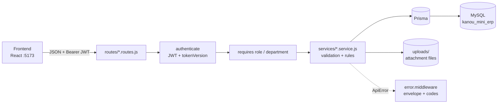
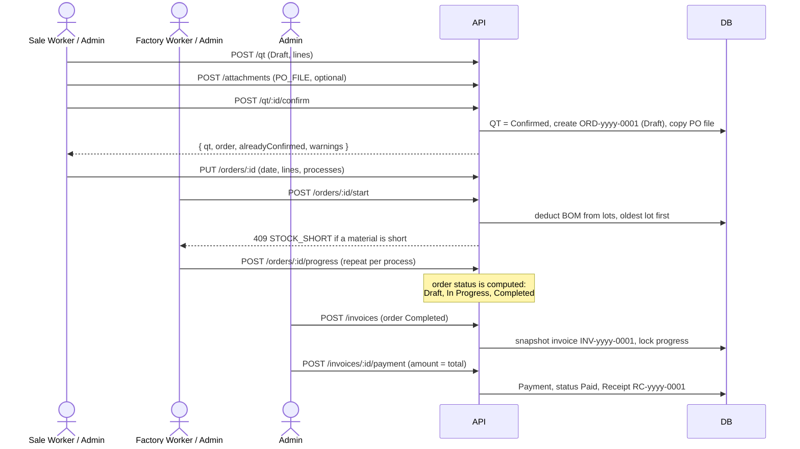
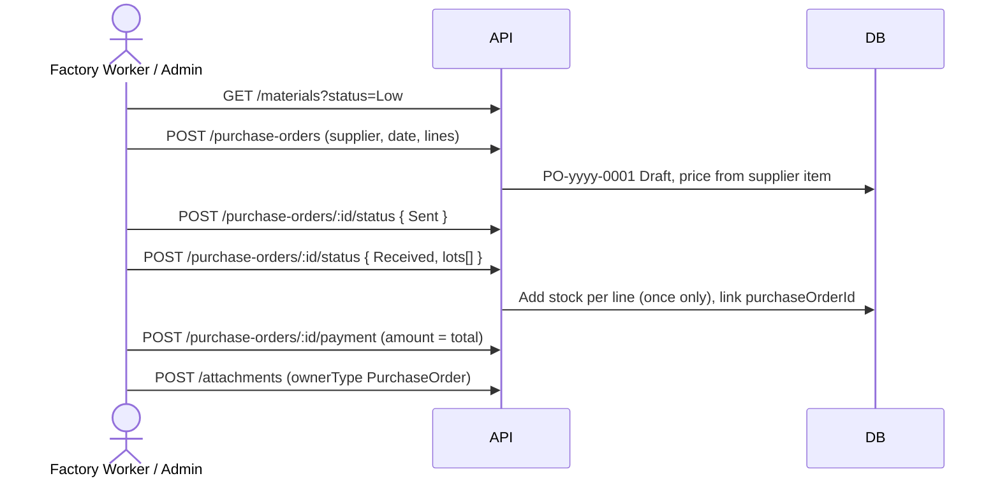
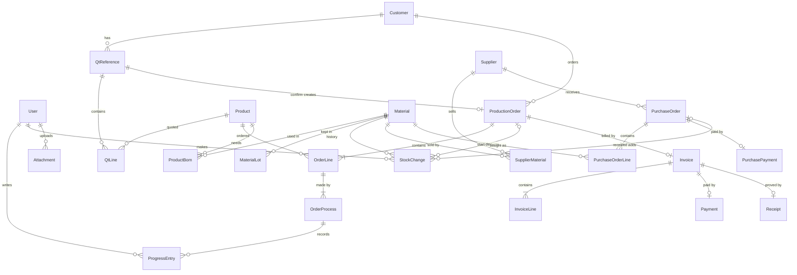

# APIs Diagram

Summary of the backend API built in `backend/` (Node.js, Express, Prisma, MySQL). Contract: [docs/api](../docs/api/README.md). Base URL `http://localhost:3000/api`. Every route except `/health` and `POST /auth/login` needs `Authorization: Bearer <token>`.

Envelope: success `{ success: true, data, meta? }`, error `{ success: false, message, error: "CODE", errors? }`.

## 1. Layers

## 2. Endpoints by module

```mermaid
flowchart TB
    API["/api"]
    API --> AUTHM["Auth"]
    API --> MASTER["Master data"]
    API --> STOCK["Stock"]
    API --> SALE["Sale"]
    API --> ACC["Accounting"]
    API --> BUY["Purchase (2.0)"]
    API --> MISC["Files / Dashboard"]

    BUY --> b1["/suppliers  GET POST PUT DELETE (items, active)"]
    BUY --> b2["/purchase-orders  GET POST PUT DELETE (Draft only)"]
    BUY --> b3["POST /purchase-orders/:id/status  Sent / Received + lots"]
    BUY --> b4["POST /purchase-orders/:id/payment"]

    AUTHM --> a1["POST /auth/login"]
    AUTHM --> a2["GET /auth/me"]
    AUTHM --> a3["POST /auth/logout"]

    MASTER --> m1["/customers  GET POST PUT DELETE"]
    MASTER --> m2["/products  GET POST PUT DELETE (with BOM)"]
    MASTER --> m3["/users  GET POST PUT DELETE"]

    STOCK --> s1["/materials  GET POST PUT DELETE (lots, total, stockStatus)"]
    STOCK --> s2["GET /materials/:id/stock-changes"]
    STOCK --> s3["POST /materials/:id/stock-changes  Add / Deduct / Adjust"]
    STOCK --> s4["GET /stock-changes  movements ledger"]

    SALE --> q1["/qt  GET POST PUT DELETE"]
    SALE --> q2["POST /qt/:id/confirm"]
    SALE --> o1["GET /orders, GET /orders/:id"]
    SALE --> o2["PUT /orders/:id  before start"]
    SALE --> o3["POST /orders/:id/start"]
    SALE --> o4["POST /orders/:id/progress"]

    ACC --> i1["GET /invoices, GET /invoices/:id"]
    ACC --> i2["POST /invoices"]
    ACC --> i3["POST /invoices/:id/payment"]
    ACC --> r1["GET /receipts, GET /receipts/:id"]

    MISC --> f1["GET /attachments?ownerType&ownerId"]
    MISC --> f2["GET /attachments/:id"]
    MISC --> f3["POST /attachments, DELETE /attachments/:id"]
    MISC --> d1["GET /dashboard"]
```

Query options added by the merged contract: `GET /qt` takes `step` (`Draft`, `Confirmed`, `InProduction`, `Done`) and every QT has a computed `step`; `GET /orders` takes `invoiced` (`true` / `false`); `GET /suppliers` takes `materialId` and `active`, and a list row has `itemCount` instead of `items`; a purchase order carries `supplierAddress` and its payment is `{ paymentDate, amount, method, referenceNo, note }`.

List calls take `q`, `page`, `pageSize` and answer `meta: { page, pageSize, total }`. `/orders`, `/qt`, `/invoices` also take `status`; `/materials` takes `status` = Normal / Low / Out; `/stock-changes` takes `type`, `from`, `to`.

## 3. Who may call

| Area | Admin | Sale Worker (`Sales`) | Factory Worker (`Factory`) |
|---|:-:|:-:|:-:|
| Dashboard, products read, materials read, stock history, orders read | yes | yes | yes |
| Customers read | yes | yes | 403 |
| Customers, products, materials, users write | yes | 403 | 403 |
| Users read | yes | 403 | 403 |
| QT (all calls, Confirm, delete a Draft) | yes | yes | 403 |
| `PUT /orders/:id` (before start) | yes | yes | 403 |
| `POST /orders/:id/start`, `/progress` | yes | 403 | yes |
| Stock change by hand | yes | 403 | yes |
| Reopen / change a Completed process | yes | 403 | 403 |
| Suppliers read; purchase orders, payment, PO files | yes | 403 | yes |
| Suppliers write | yes | 403 | 403 |
| Invoices, payments, receipts | yes | 403 | 403 |
| Files of a QT (read, upload, delete) | yes | yes | 403 |
| Files of an order: read | yes | yes | yes |
| Files of an order: upload, delete | yes | 403 | yes |

The role check runs before the record lookup, so a forbidden user gets `403`, not `404`.

## 4. One sale, end to end

### Purchase flow

## 5. Order and invoice states

```mermaid
stateDiagram-v2
    direction LR
    [*] --> QT_Draft
    QT_Draft --> QT_Confirmed: POST /qt/:id/confirm (once)
    QT_Confirmed --> Order_Draft: order created

    state "Order Draft" as Order_Draft
    Order_Draft --> Order_Started: POST start (deducts stock)
    Order_Started --> Order_InProgress: first process moves
    Order_InProgress --> Order_Completed: every process Completed

    Order_Completed --> Invoice_Unpaid: POST /invoices
    Invoice_Unpaid --> Invoice_Paid: POST payment (amount = total)
    Invoice_Paid --> [*]: receipt issued
```

## 6. Data model (tables)

`Attachment` points to its owner (`QtReference` or `ProductionOrder`) by `ownerType` + `ownerId`, with no database foreign key.

## 7. Error codes

| HTTP | `error` | Typical cause |
|---:|---|---|
| 400 | `VALIDATION_ERROR` | `errors: [{ path, code }]`, codes `REQUIRED`, `INVALID`, `INVALID_DATE`, `DUPLICATE`, `TOO_SHORT`, `TOO_HIGH`, `MUST_EQUAL_TOTAL`, `FILE_TYPE`, `FILE_TOO_BIG` ... |
| 401 | `UNAUTHORIZED`, `INVALID_CREDENTIALS` | No / bad / old token; wrong login |
| 403 | `FORBIDDEN`, `COMPLETED_LOCKED` | Role or department not allowed |
| 404 | `NOT_FOUND` | No such record |
| 409 | `DUPLICATE_VALUE` | Unique `code`, `email`, `qtNumber` used |
| 409 | `IN_USE` | Delete of a used record; `errors: [{ kind, count, items }]` |
| 409 | `STOCK_SHORT`, `STOCK_NEGATIVE`, `LOT_NOT_FOUND` | Stock rules |
| 409 | `QT_LOCKED`, `ORDER_LOCKED`, `ALREADY_STARTED`, `ORDER_NOT_READY`, `ORDER_NOT_STARTED`, `ORDER_INVOICED` | Order / QT lifecycle |
| 409 | `PO_LOCKED`, `INVALID_STATUS_CHANGE`, `PO_NOT_RECEIVED` | Purchase order lifecycle (`ALREADY_PAID` also covers a PO) |
| 400 | `SUPPLIER_INACTIVE`, `NOT_SOLD_BY_SUPPLIER` (codes inside `VALIDATION_ERROR`) | Purchase order lines |
| 409 | `ORDER_NOT_COMPLETED`, `INVOICE_EXISTS`, `ALREADY_PAID`, `FILE_LOCKED` | Accounting and files |
| 429 | `TOO_MANY_REQUESTS` | Login rate limit |
| 500 | `INTERNAL_SERVER_ERROR` | Unexpected failure |

## 8. Tests

`cd backend && pnpm test` runs integration tests (Node test runner) that call the real Express app over HTTP against a separate database, `kanou_mini_erp_test` (made from `DATABASE_URL` with `_test` added; the tests refuse to run on any other name, because they empty every table). The schema is pushed by `test-support/setup-db.js` first.

| File | Covers |
|---|---|
| `test/auth.test.js` | login, `/me`, logout, sessions ended by a new password, rate limit, 401 on every module |
| `test/master.test.js` | customers, products with BOM, users: validation, search, paging, roles, `IN_USE`, duplicates |
| `test/stock.test.js` | materials, lots, status, stock changes (Add / Deduct / Adjust), history, movements, delete rules |
| `test/sale.test.js` | QT, Confirm QT, files (PO copy to the order), production orders, start (stock deduction), progress rules |
| `test/accounting.test.js` | invoices (snapshot), payment, receipts, dashboard |
| `test/purchase.test.js` | suppliers, purchase orders, status path, receiving (stock once), payment, files, in-use rules |

## 9. Status

All endpoints above are implemented in `backend/src` and covered by the tests. The development database `kanou_mini_erp` still has to be created with `pnpm run db:setup` (users `admin@gmail.com` / `admin`, `worker@gmail.com` / `worker`, `sale@gmail.com` / `sale`).
