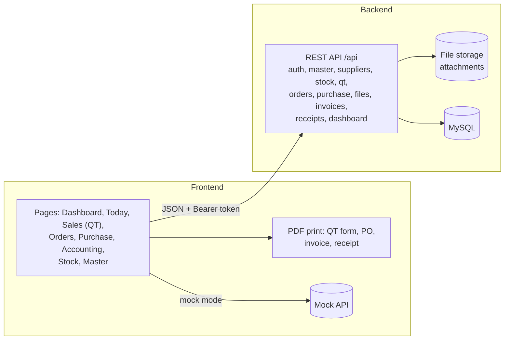

# Context Diagram

## Level 0: system context

## Level 1: inside the system

## External entities

| Entity | Gives the system | Gets from the system |
|---|---|---|
| Admin | master data, invoices, payments, any action | all pages, invoice and receipt |
| Sale Worker | QT, customer PO file, order edits | QT form PDF, order and stock views |
| Factory Worker | progress, evidence files, stock changes, PO and its status and payment | orders, stock, PO PDF |
| Customer (outside) | customer PO, payment | QT form, invoice, receipt (handed over by users) |
| Supplier (outside) | goods, quotation | PO PDF (handed over by the user) |

## Data stores added in Version 2.0

| Store | Content |
|---|---|
| Purchase data | suppliers, supplier items and prices, POs, PO lines, PO payments |
| Attachments | PO files, quotations, production evidence, other documents |

## Not in this system

Sales orders, delivery, supplier invoices in Accounting, serial numbers and tax.
