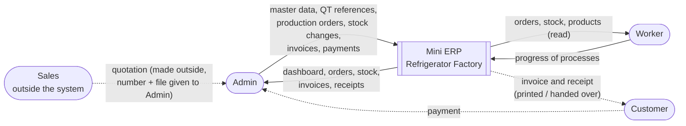
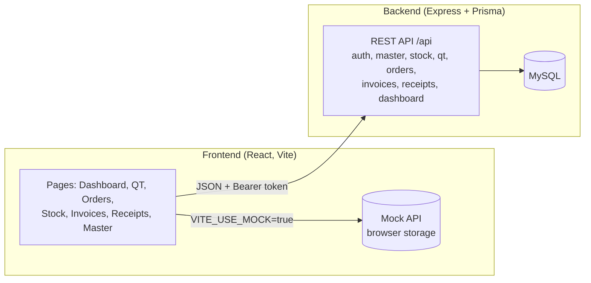

# Context Diagram

The Mini ERP as one system, with the people and the outside things it deals with. (Asked as "Contact Diagram"; read as the context diagram.)

## Level 0: system context

## Level 1: inside the system

## External entities

| Entity | Gives the system | Gets from the system |
|---|---|---|
| Admin | master data, QT references, orders, stock changes, invoices, payments | dashboard, all lists, invoice and receipt documents |
| Worker | progress entries | orders, stock, products (read only) |
| Sales (outside) | the quotation, made outside the system | nothing directly |
| Customer (outside) | payment (to the Admin) | invoice and receipt, handed over by the Admin |

## Not in this system

Sales orders, delivery, purchase orders, serial numbers and tax. They are in the big system on branch `jay`.
