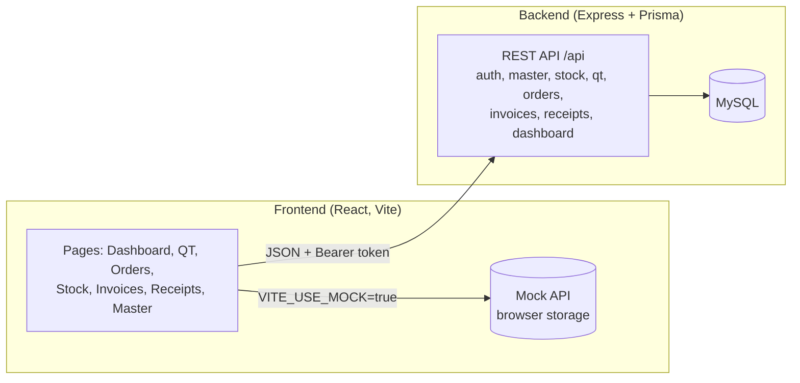
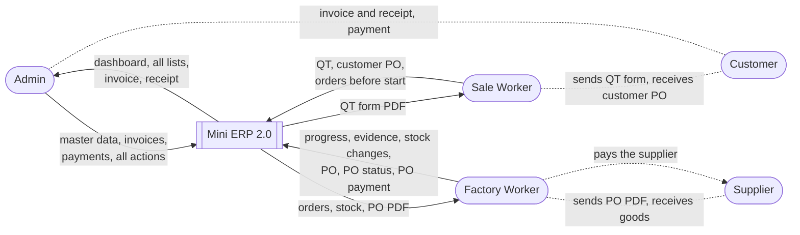
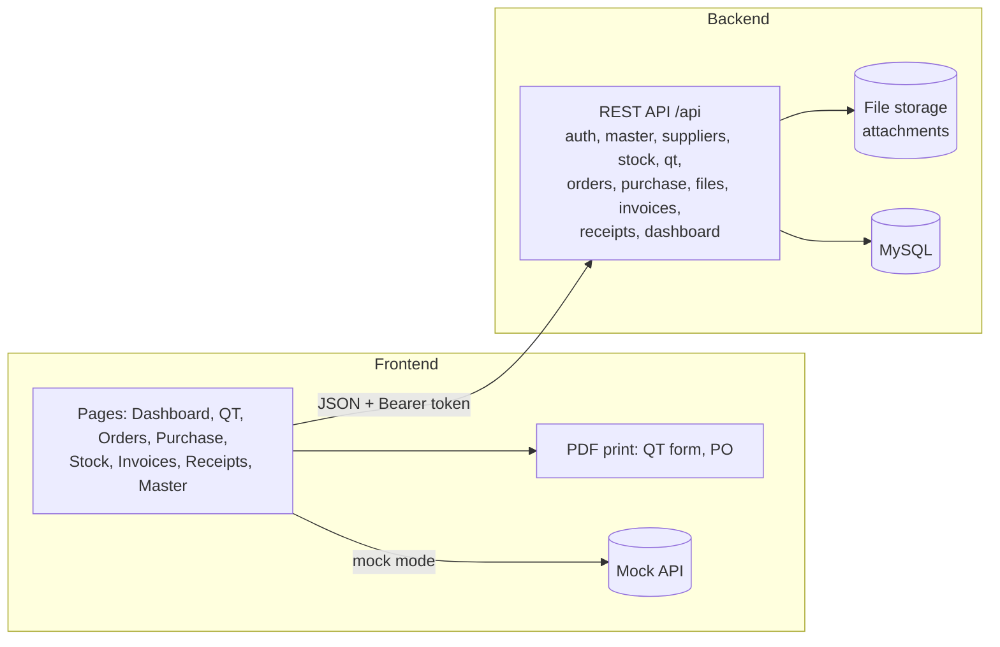

# Context Diagram

One file with both versions: **Part 1** is the system as built on branch `mini-erp`; **Part 2** is Version 2.0 (planned): Purchase ([Purchase Logic Draft2](../docs/Purchase%20Logic%20Draft2.md)), QT Upgrade 2.0 ([doc](../docs/QT%20Upgrade%202.0.md)) and User Version 2.0 ([doc](../docs/User%20Version%202.0.md)).

## Part 1: Current version (as built)

The Mini ERP as one system, with the people and the outside things it deals with. (Asked as "Contact Diagram"; read as the context diagram.)

### Level 0: system context

### Level 1: inside the system

### External entities

| Entity | Gives the system | Gets from the system |
|---|---|---|
| Admin | master data, QT references, orders, stock changes, invoices, payments | dashboard, all lists, invoice and receipt documents |
| Worker | progress entries | orders, stock, products (read only) |
| Sales (outside) | the quotation, made outside the system | nothing directly |
| Customer (outside) | payment (to the Admin) | invoice and receipt, handed over by the Admin |

### Not in this system

Sales orders, delivery, purchase orders, serial numbers and tax. They are in the big system on branch `jay`.

---

## Part 2: Version 2.0 (planned)

The Mini ERP with Purchase added, the two Worker departments, and printed documents. The current version is in [Part 1](#part-1-current-version-as-built).

### Level 0: system context

### Level 1: inside the system

### External entities

| Entity | Gives the system | Gets from the system |
|---|---|---|
| Admin | master data, invoices, payments, any action | all pages, invoice and receipt |
| Sale Worker | QT, customer PO file, order edits | QT form PDF, order and stock views |
| Factory Worker | progress, evidence files, stock changes, PO and its status and payment | orders, stock, PO PDF |
| Customer (outside) | customer PO, payment | QT form, invoice, receipt (handed over by users) |
| Supplier (outside) | goods, quotation | PO PDF (handed over by the user) |

### Data stores that are new

| Store | Content |
|---|---|
| Purchase data | suppliers, supplier items and prices, POs, PO lines, PO payments |
| Attachments | PO files, quotations, production evidence, other documents |

### Not in this system

Sales orders, delivery, supplier invoices in Accounting, serial numbers and tax.
