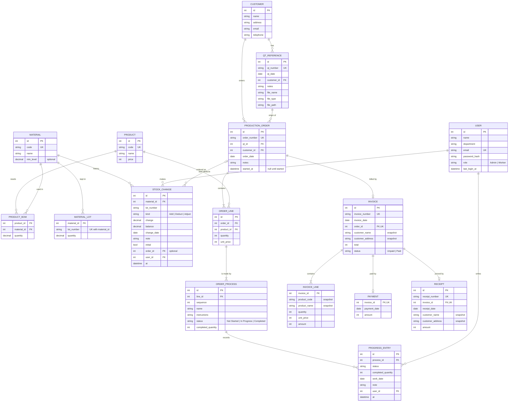

# ER Diagram

Entities of the Mini ERP (branch `mini-erp`). Source: the `Table(...)` sketches in [docs/api](../docs/api/README.md). Only `User` exists in the backend today; the rest is the contract the backend has to build.

## Notes

- `Invoice` and `Receipt` copy the customer name, address and product data when they are issued (a **snapshot**), so later changes to master data do not change them.
- An order is billed once (`order_id` unique on `Invoice`), and an invoice has at most one payment and one receipt.
- `Order status` (New, In Progress, Completed) is **computed** from the processes. It is not a column.
- Stock status (`Normal`, `Low`, `Out`) is computed from the lot totals and `min_level`.
