# ER Diagram

The system as built on branch `mini-erp` (Version 2.0): the three changes ([Purchase Logic Draft2](../docs/Purchase%20Logic%20Draft2.md), [QT Upgrade 2.0](../docs/QT%20Upgrade%202.0.md), [User Version 2.0](../docs/User%20Version%202.0.md)) are in. This replaces the older single-version description.

```mermaid
erDiagram
    USER {
        int id PK
        string name
        string department "Sales | Factory | Accounting | Administration"
        string email UK
        string password_hash
        string role "Admin | Worker"
    }
    CUSTOMER {
        int id PK
        string name
        string address
        string email
        string telephone
    }
    SUPPLIER {
        int id PK
        string code UK
        string name
        string contact
        string address
        bool active
    }
    SUPPLIER_MATERIAL {
        int supplier_id FK
        int material_id FK
        int unit_price "initial price"
    }
    PRODUCT {
        int id PK
        string code UK
        string name
        int price
    }
    MATERIAL {
        int id PK
        string code UK
        string name
        string unit
        decimal min_level
    }
    PRODUCT_BOM {
        int product_id FK
        int material_id FK
        decimal quantity
    }
    MATERIAL_LOT {
        int material_id FK
        string lot_number
        decimal quantity
    }
    STOCK_CHANGE {
        int id PK
        int material_id FK
        string lot_number
        string kind "Add | Deduct | Adjust"
        decimal change
        decimal balance
        int order_id FK "start production"
        int purchase_order_id FK "PO received"
        int user_id FK
    }
    QT_REFERENCE {
        int id PK
        string qt_number UK
        date qt_date
        int customer_id FK
        string status "Draft | Confirmed"
        string customer_po_number
        date customer_po_date
        int production_order_id FK "set on confirm"
        string notes
    }
    QT_LINE {
        int id PK
        int qt_id FK
        int product_id FK
        int quantity
        int unit_price
        int amount
    }
    PRODUCTION_ORDER {
        int id PK
        string order_number UK
        int qt_id FK
        int customer_id FK
        date order_date
        datetime started_at
    }
    ORDER_LINE {
        int id PK
        int order_id FK
        int product_id FK
        int quantity
        int unit_price
    }
    ORDER_PROCESS {
        int id PK
        int line_id FK
        string name
        string status
    }
    PROGRESS_ENTRY {
        int id PK
        int process_id FK
        string status
        int user_id FK
    }
    PURCHASE_ORDER {
        int id PK
        string po_number UK
        int supplier_id FK
        string department "Sales | Factory | ..."
        date required_date
        string status "Draft | Sent | Received"
        int total
        datetime received_at
        int created_by FK
    }
    PURCHASE_ORDER_LINE {
        int id PK
        int po_id FK
        int material_id FK
        decimal quantity
        string unit
        int unit_price
        int amount
    }
    PURCHASE_PAYMENT {
        int po_id FK,UK
        date payment_date
        int amount
        string method
        string reference_no
        string note
    }
    ATTACHMENT {
        int id PK
        string owner_type "PurchaseOrder | QtReference | ProductionOrder"
        int owner_id
        string kind "PO_FILE | QUOTATION | EVIDENCE | OTHER"
        string file_name
        string file_type
        string file_path
        int uploaded_by FK
        datetime at
    }
    INVOICE {
        int id PK
        string invoice_number UK
        int order_id FK,UK
        int total
        string status
    }
    INVOICE_LINE {
        int invoice_id FK
        string product_code
        int quantity
        int amount
    }
    PAYMENT {
        int invoice_id FK,UK
        date payment_date
        int amount
    }
    RECEIPT {
        int id PK
        string receipt_number UK
        int invoice_id FK,UK
        int amount
    }

    CUSTOMER ||--o{ QT_REFERENCE : "has"
    QT_REFERENCE ||--|{ QT_LINE : "contains"
    PRODUCT ||--o{ QT_LINE : "quoted as"
    QT_REFERENCE ||--o| PRODUCTION_ORDER : "confirm creates"
    CUSTOMER ||--o{ PRODUCTION_ORDER : "orders"
    PRODUCTION_ORDER ||--|{ ORDER_LINE : "contains"
    PRODUCT ||--o{ ORDER_LINE : "ordered as"
    ORDER_LINE ||--|{ ORDER_PROCESS : "made by"
    ORDER_PROCESS ||--o{ PROGRESS_ENTRY : "records"
    USER ||--o{ PROGRESS_ENTRY : "writes"
    PRODUCT ||--o{ PRODUCT_BOM : "needs"
    MATERIAL ||--o{ PRODUCT_BOM : "used in"
    MATERIAL ||--o{ MATERIAL_LOT : "kept in"
    MATERIAL ||--o{ STOCK_CHANGE : "history"
    SUPPLIER ||--o{ SUPPLIER_MATERIAL : "sells"
    MATERIAL ||--o{ SUPPLIER_MATERIAL : "sold by"
    SUPPLIER ||--o{ PURCHASE_ORDER : "receives"
    PURCHASE_ORDER ||--|{ PURCHASE_ORDER_LINE : "contains"
    MATERIAL ||--o{ PURCHASE_ORDER_LINE : "bought as"
    PURCHASE_ORDER ||--o| PURCHASE_PAYMENT : "paid by"
    PURCHASE_ORDER o|--o{ STOCK_CHANGE : "received adds"
    USER ||--o{ PURCHASE_ORDER : "creates"
    PURCHASE_ORDER ||--o{ ATTACHMENT : "files"
    QT_REFERENCE ||--o{ ATTACHMENT : "files"
    PRODUCTION_ORDER ||--o{ ATTACHMENT : "evidence"
    PRODUCTION_ORDER ||--o| INVOICE : "billed by"
    INVOICE ||--|{ INVOICE_LINE : "contains"
    INVOICE ||--o| PAYMENT : "paid by"
    INVOICE ||--o| RECEIPT : "proved by"
```

## What Version 2.0 added

| Source | Change |
|---|---|
| Purchase | New tables `Supplier`, `SupplierMaterial`, `PurchaseOrder`, `PurchaseOrderLine`, `PurchasePayment`. `StockChange.purchase_order_id` links a received PO to the stock it added |
| QT 2.0 | `QtReference` gets `status`, `customer_po_number`, `customer_po_date`, `production_order_id`. New `QtLine`. The old QT file and the customer PO file move to `Attachment` |
| Files | New `Attachment` table, shared by PO, QT and production order (evidence). Replaces `file_name`, `file_type`, `file_path` on `QtReference` |
| User 2.0 | No new column. A Worker's `department` must be `Sales` or `Factory` and decides access |
| Material | `unit` added (the PO lines need a unit) |

## Notes

- `Attachment` is polymorphic (`owner_type` + `owner_id`), so there is no database foreign key to the owner; the service checks it.
- `PurchasePayment` is stored on the PO and does not go through the Accounting tables.
- `QT_REFERENCE.production_order_id` is unique: one QT creates one Factory Order.
- Invoice, Payment and Receipt are unchanged and keep their snapshot fields (not repeated here).
- `Order status` (`Draft`, `In Progress`, `Completed`) is **computed** from the processes; it is not a column. The stock status (`Normal`, `Low`, `Out`) is computed from the lot totals and `min_level`.
- `Invoice` and `Receipt` copy the customer and the product data when they are issued (a snapshot). An order is billed once, and an invoice has at most one payment and one receipt.
- An order is made only by Confirm QT, so `ProductionOrder.qt_id` is always set and each QT has at most one order.
