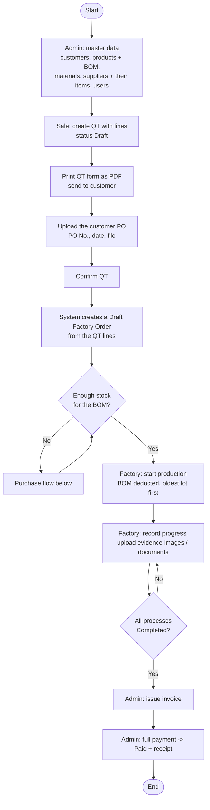
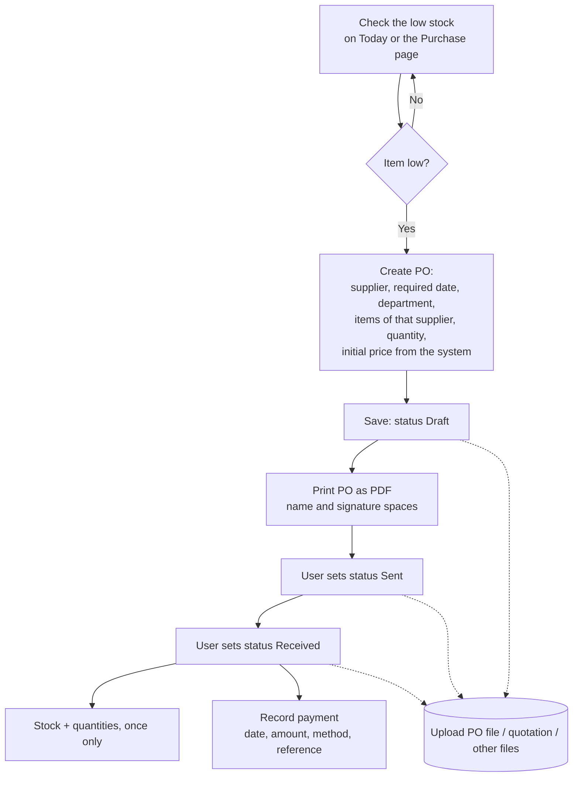
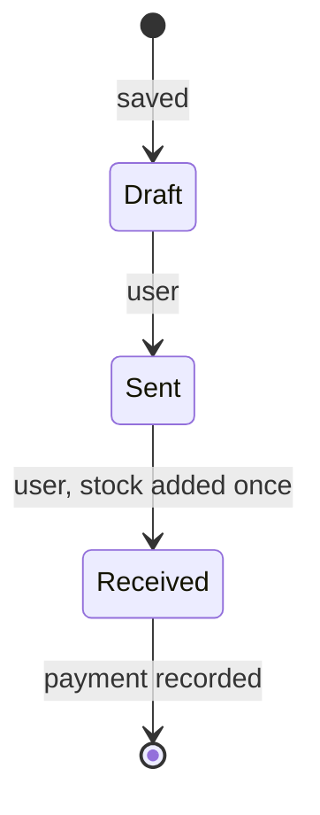
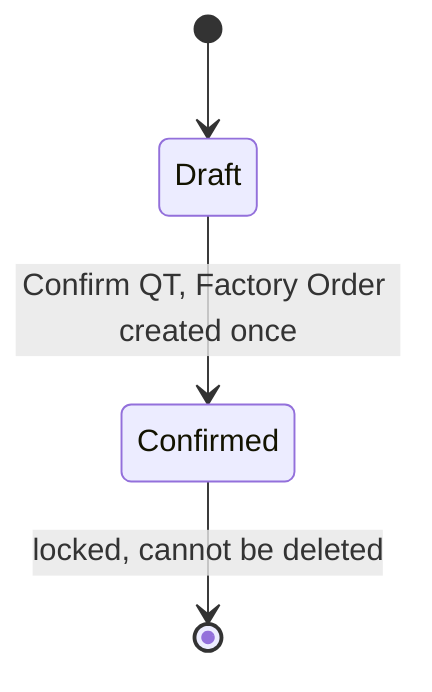
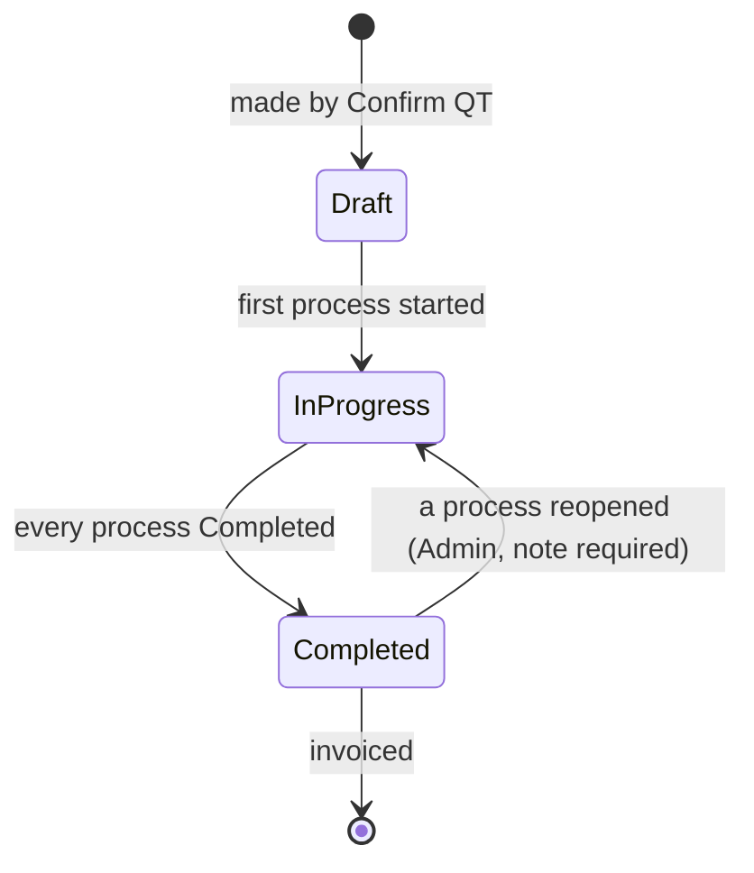
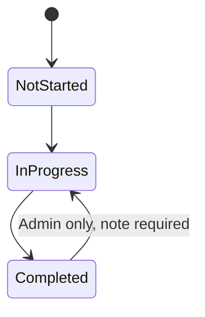
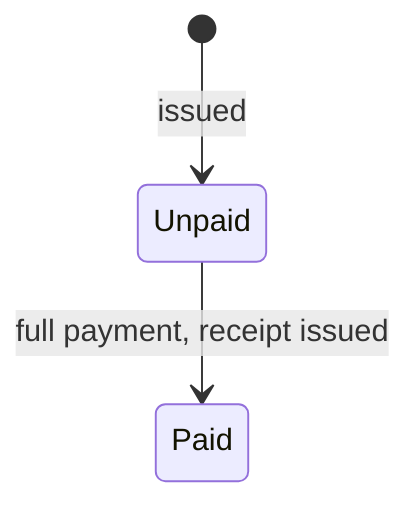
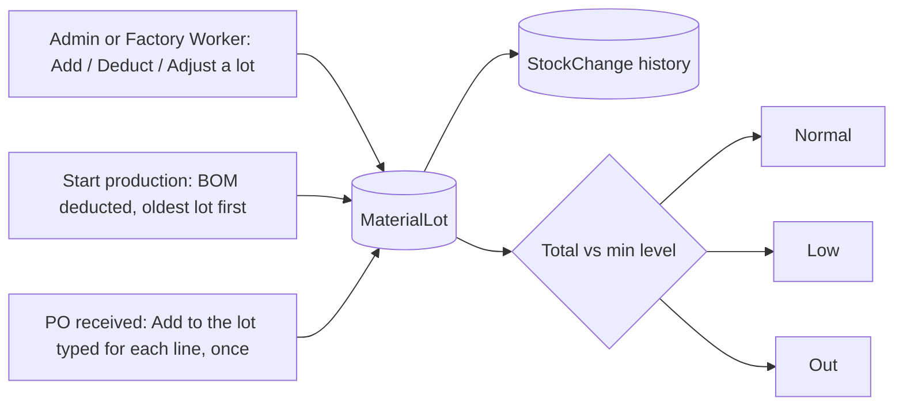
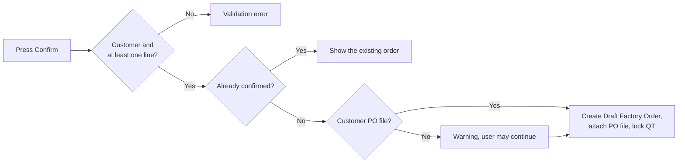

# Flow Chart

The system as built on branch `mini-erp` (Version 2.0): the three changes ([Purchase Logic Draft2](../docs/Purchase%20Logic%20Draft2.md), [QT Upgrade 2.0](../docs/QT%20Upgrade%202.0.md), [User Version 2.0](../docs/User%20Version%202.0.md)) are in. This replaces the older single-version description.

## Main flow

## Purchase flow

## PO status

Lines can be edited only in `Draft`. A `Draft` PO can be deleted.

## QT status

## Order status

The status of an order is computed from its processes, not set by hand. `Draft` also covers an order that was started but has no progress yet (the page says "Production started").

## Process status

## Invoice status

## Stock changes

## Confirm QT: checks

