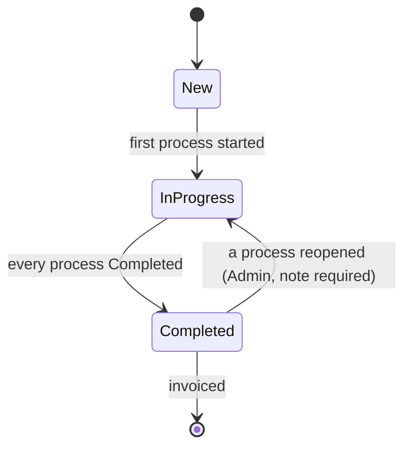
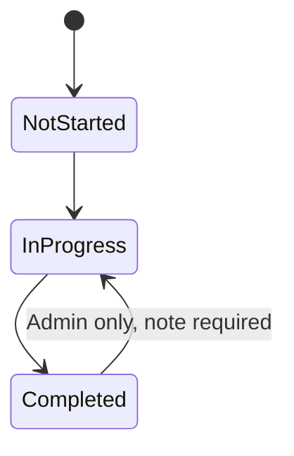
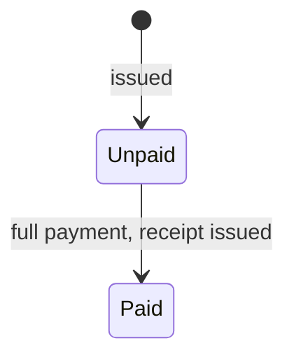
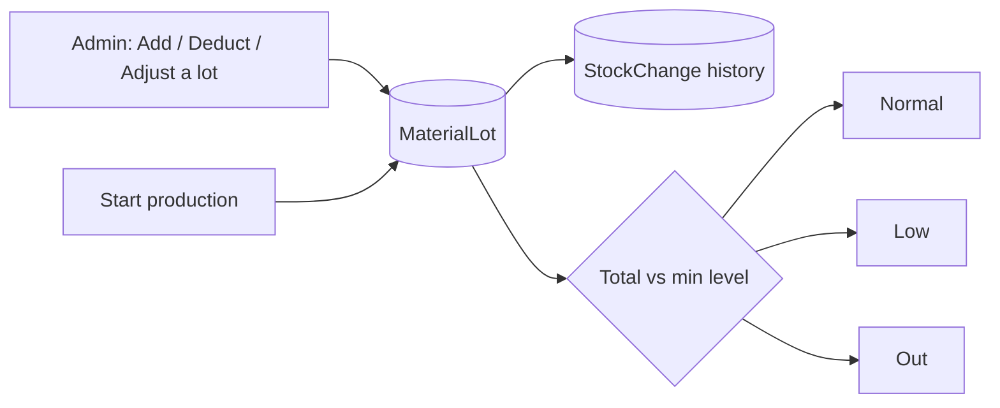
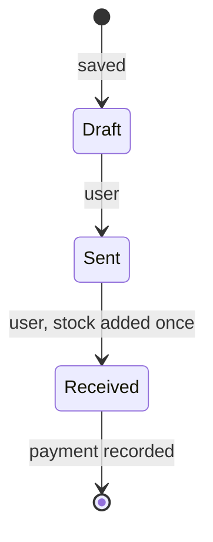
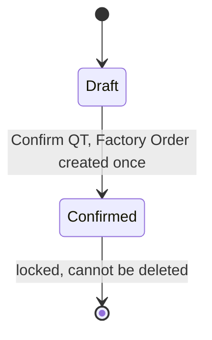
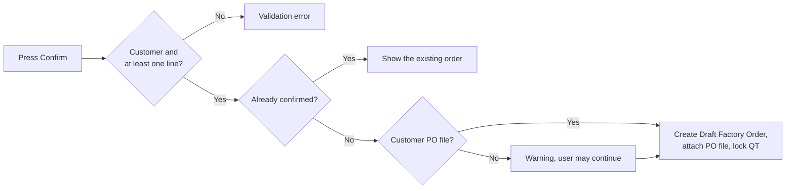

# Flow Chart

One file with both versions: **Part 1** is the system as built on branch `mini-erp`; **Part 2** is Version 2.0 (planned): Purchase ([Purchase Logic Draft2](../docs/Purchase%20Logic%20Draft2.md)), QT Upgrade 2.0 ([doc](../docs/QT%20Upgrade%202.0.md)) and User Version 2.0 ([doc](../docs/User%20Version%202.0.md)).

## Part 1: Current version (as built)

The business flow of the Mini ERP, from master data to the receipt. Source: [README.md](../README.md) (Workflow) and [docs/api](../docs/api/README.md).

### Main flow

### Order status

The status of an order is computed from its processes, not set by hand.

### Process status

### Invoice status

### Stock change

---

## Part 2: Version 2.0 (planned)

Business flow after the three changes. The current flow is in [Part 1](#part-1-current-version-as-built).

### Main flow

### Purchase flow

### PO status

Lines can be edited only in `Draft`. A `Draft` PO can be deleted.

### QT status

### Order, process and invoice status

Unchanged: see [Part 1](#part-1-current-version-as-built).

### Confirm QT: checks

