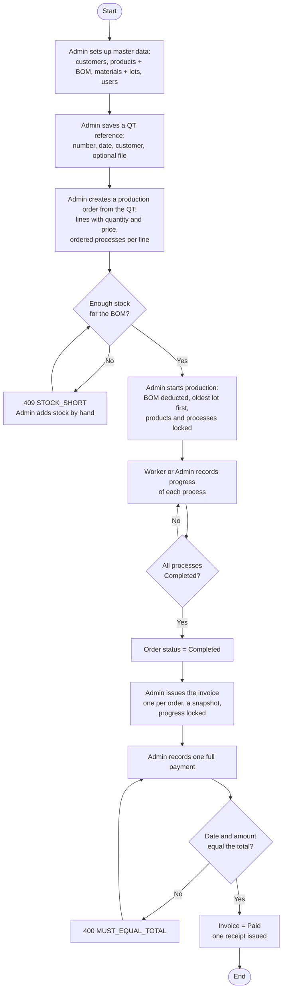
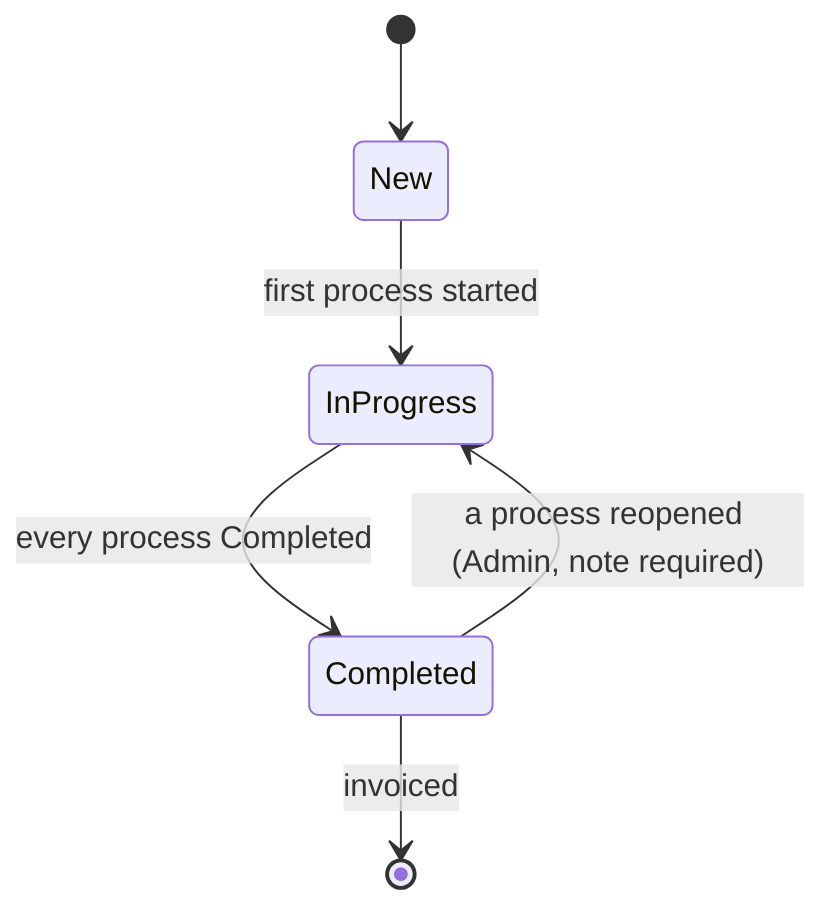
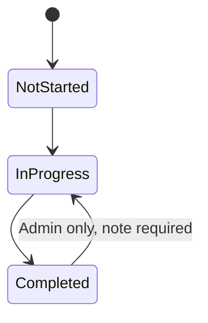
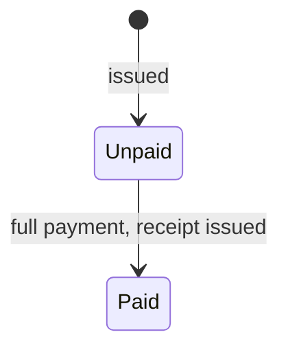
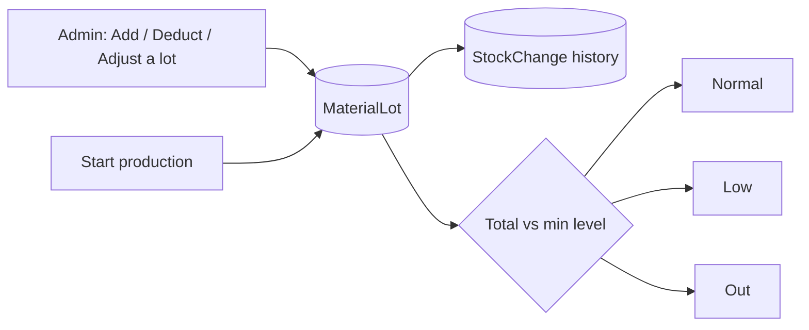

# Flow Chart

The business flow of the Mini ERP, from master data to the receipt. Source: [README.md](../README.md) (Workflow) and [docs/api](../docs/api/README.md).

## Main flow

## Order status

The status of an order is computed from its processes, not set by hand.

## Process status

## Invoice status

## Stock change

