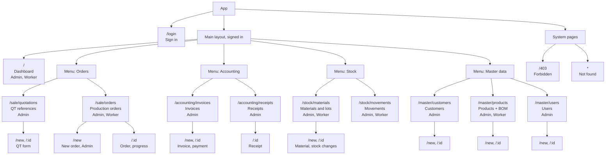
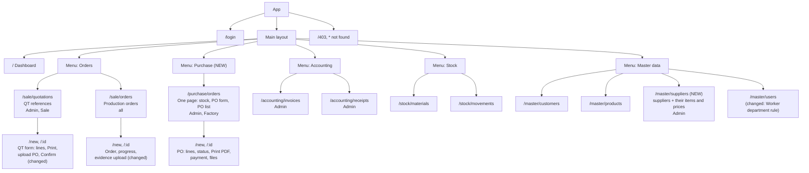

# Site Map

One file with both versions: **Part 1** is the system as built on branch `mini-erp`; **Part 2** is Version 2.0 (planned): Purchase ([Purchase Logic Draft2](../docs/Purchase%20Logic%20Draft2.md)), QT Upgrade 2.0 ([doc](../docs/QT%20Upgrade%202.0.md)) and User Version 2.0 ([doc](../docs/User%20Version%202.0.md)).

## Part 1: Current version (as built)

Every page of the frontend, with the role that can open it. Source: [frontend/src/config/navigation.js](../frontend/src/config/navigation.js) and [frontend/src/routes/index.jsx](../frontend/src/routes/index.jsx). The menu is in the header.

### Page table

| Menu | Page | Path | Admin | Worker |
|---|---|---|---|---|
| Dashboard | Dashboard | `/` | yes | yes (order tiles only) |
| Orders | QT references | `/sale/quotations` | yes | no |
| Orders | Production orders | `/sale/orders` | yes | yes (view, progress) |
| Accounting | Invoices | `/accounting/invoices` | yes | no |
| Accounting | Receipts | `/accounting/receipts` | yes | no |
| Stock | Materials | `/stock/materials` | yes | read only |
| Stock | Movements | `/stock/movements` | yes | read only |
| Master data | Customers | `/master/customers` | yes | no |
| Master data | Products | `/master/products` | yes | read only |
| Master data | Users | `/master/users` | yes | no |
| – | Sign in | `/login` | guests | guests |
| – | Forbidden / Not found | `/403`, `*` | any | any |

### Redirects

- `/stock` opens `/stock/materials`; `/stock/:id` is redirected to the material page.
- Old addresses of moved pages are redirected to their new place (`MovedRedirect`).
- A menu with one visible entry is shown as that entry alone (for example a Worker sees "Production orders" without the Orders menu).

---

## Part 2: Version 2.0 (planned)

Pages after the three changes. The current site map is in [Part 1](#part-1-current-version-as-built). **New** pages are marked. Paths for new pages are proposed, not built.

### Page table

| Menu | Page | Path | Admin | Sale Worker | Factory Worker |
|---|---|---|---|---|---|
| Dashboard | Dashboard | `/` | all | orders | orders |
| Orders | QT references | `/sale/quotations` | yes | yes | no |
| Orders | Production orders | `/sale/orders` | yes | view + edit before start | view + start + progress |
| **Purchase** | **Purchase orders (new)** | `/purchase/orders` | yes | no | yes |
| Accounting | Invoices | `/accounting/invoices` | yes | no | no |
| Accounting | Receipts | `/accounting/receipts` | yes | no | no |
| Stock | Materials | `/stock/materials` | yes | view | change |
| Stock | Movements | `/stock/movements` | yes | view | view |
| Master data | Customers | `/master/customers` | yes | view | no |
| Master data | Products | `/master/products` | yes | view | view |
| **Master data** | **Suppliers (new)** | `/master/suppliers` | yes | no | view |
| Master data | Users | `/master/users` | yes | no | no |
| – | Sign in, Forbidden, Not found | `/login`, `/403`, `*` | any | any | any |

### What changed on existing pages

| Page | Change |
|---|---|
| QT form | adds lines and total, Print button, customer PO upload (number, date, file), Confirm button, status, link to the created order |
| Production order | shows the customer PO file, QT link, and an evidence upload area |
| Users | a Worker must choose `Sales` or `Factory` |
| Menus | each entry has `roles` and `departments`; a menu with one visible entry shows as that entry |

### The Purchase page (one page)

| Area | Content |
|---|---|
| Stock | material, remaining, low flag, "Create PO" |
| PO form | supplier, required date, department, item lines, quantity, price, total |
| PO list | PO No., supplier, required date, status buttons |
| PO detail | lines, Print PDF, payment, attachments |
