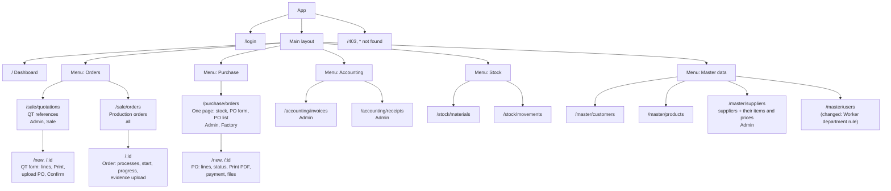

# Site Map

The system as built on branch `mini-erp` (Version 2.0): the three changes ([Purchase Logic Draft2](../docs/Purchase%20Logic%20Draft2.md), [QT Upgrade 2.0](../docs/QT%20Upgrade%202.0.md), [User Version 2.0](../docs/User%20Version%202.0.md)) are in. This replaces the older single-version description.

## Page table

| Menu | Page | Path | Admin | Sale Worker | Factory Worker |
|---|---|---|---|---|---|
| Dashboard | Dashboard | `/` | all | orders | orders |
| Orders | QT references | `/sale/quotations` | yes | yes | no |
| Orders | Production orders | `/sale/orders` | yes | view + edit before start | view + start + progress |
| Purchase | Purchase orders | `/purchase/orders` | yes | no | yes |
| Accounting | Invoices | `/accounting/invoices` | yes | no | no |
| Accounting | Receipts | `/accounting/receipts` | yes | no | no |
| Stock | Materials | `/stock/materials` | yes | view | change |
| Stock | Movements | `/stock/movements` | yes | view | view |
| Master data | Customers | `/master/customers` | yes | view | no |
| Master data | Products | `/master/products` | yes | view | view |
| Master data | Suppliers | `/master/suppliers` | yes | no | view |
| Master data | Users | `/master/users` | yes | no | no |
| – | Sign in, Forbidden, Not found | `/login`, `/403`, `*` | any | any | any |

## What is on the pages that QT 2.0 and the roles changed

| Page | Change |
|---|---|
| QT form | adds lines and total, Print button, customer PO upload (number, date, file), Confirm button, status, link to the created order |
| Production order | shows the customer PO file, QT link, and an evidence upload area |
| Users | a Worker must choose `Sales` or `Factory` |
| Menus | each entry has `roles` and `departments`; a menu with one visible entry shows as that entry |

## The Purchase page (one page)

| Area | Content |
|---|---|
| Stock | material, remaining, low flag, "Create PO" |
| PO form | supplier, required date, department, item lines, quantity, price, total |
| PO list | PO No., supplier, required date, status buttons |
| PO detail | lines, Print PDF, payment, attachments |

## Redirects

- `/stock` opens `/stock/materials`; `/stock/:id` is redirected to the material page.
- `/sale/orders/new` opens `/sale/quotations`: an order is made by Confirm QT, never by hand.
- Old addresses of pages that moved (`/qt`, `/orders`, `/invoices`, ...) are redirected to their new place.
- A menu with one visible entry is shown as that entry alone.
