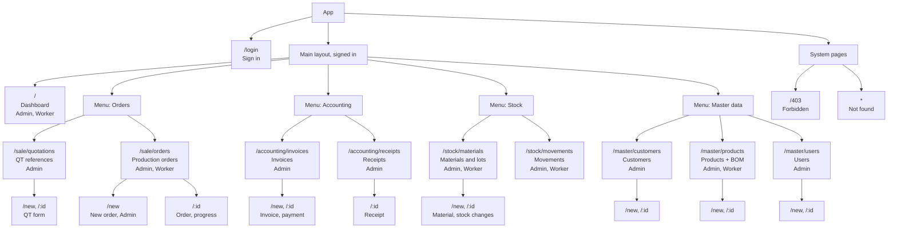

# Site Map

Every page of the frontend, with the role that can open it. Source: [frontend/src/config/navigation.js](../frontend/src/config/navigation.js) and [frontend/src/routes/index.jsx](../frontend/src/routes/index.jsx). The menu is in the header.

## Page table

| Menu | Page | Path | Admin | Worker |
|---|---|---|---|---|
| Dashboard | Dashboard | `/` | yes | yes (order tiles only) |
| Orders | QT references | `/sale/quotations` | yes | no |
| Orders | Production orders | `/sale/orders` | yes | yes (view, progress) |
| Accounting | Invoices | `/accounting/invoices` | yes | no |
| Accounting | Receipts | `/accounting/receipts` | yes | no |
| Stock | Materials | `/stock/materials` | yes | read only |
| Stock | Movements | `/stock/movements` | yes | read only |
| Master data | Customers | `/master/customers` | yes | no |
| Master data | Products | `/master/products` | yes | read only |
| Master data | Users | `/master/users` | yes | no |
| – | Sign in | `/login` | guests | guests |
| – | Forbidden / Not found | `/403`, `*` | any | any |

## Redirects

- `/stock` opens `/stock/materials`; `/stock/:id` is redirected to the material page.
- Old addresses of moved pages are redirected to their new place (`MovedRedirect`).
- A menu with one visible entry is shown as that entry alone (for example a Worker sees "Production orders" without the Orders menu).
