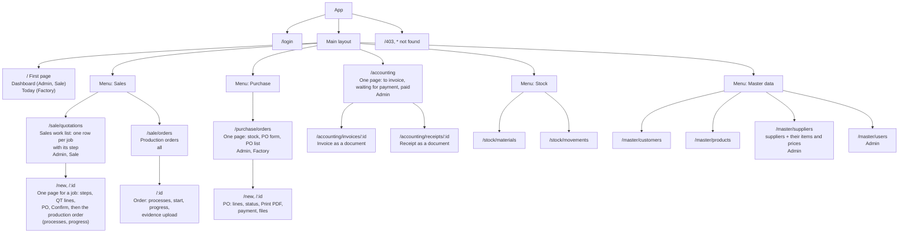

# Site Map

## Page table

| Menu | Page | Path | Admin | Sale Worker | Factory Worker |
|---|---|---|---|---|---|
| Dashboard / Today | Dashboard (Admin, Sale), Today (Factory) | `/` | all | orders | work of today |
| Sales | Sales work list and one page for a job | `/sale/quotations` | yes | yes | no |
| Sales | Production orders | `/sale/orders` | yes | view + edit before start | view + start + progress |
| Purchase | Purchase orders | `/purchase/orders` | yes | no | yes |
| Accounting | Work list | `/accounting` | yes | no | no |
| Accounting | Invoice and receipt documents | `/accounting/invoices/:id`, `/accounting/receipts/:id` | yes | no | no |
| Stock | Materials | `/stock/materials` | yes | view | change |
| Stock | Movements | `/stock/movements` | yes | view | view |
| Master data | Customers | `/master/customers` | yes | view | no |
| Master data | Products | `/master/products` | yes | view | view |
| Master data | Suppliers | `/master/suppliers` | yes | no | view |
| Master data | Users | `/master/users` | yes | no | no |
| – | Sign in, Forbidden, Not found | `/login`, `/403`, `*` | any | any | any |

## What is on each page

| Page | Content |
|---|---|
| Sign in | email and password |
| Dashboard (Admin, Sale) | order tiles (Draft, In progress, Completed); for the Admin also the invoice tiles and a chart of orders by status |
| Today (Factory) | orders to start, orders in production with a big "Record progress" button, purchase orders to receive, a strip for low stock |
| Sales work list | one row per job with its step (Draft, Confirmed, In production, Done) |
| QT page (one page for a job) | the steps of the job, customer, lines and total, Print button, customer PO upload (number, date, file), Confirm button; after Confirm the production order of the job on the same page: processes before the start, progress after it |
| Production orders | list of orders with their status |
| Production order | processes, start, progress, the customer PO file, QT link, evidence upload (images and documents) |
| Purchase orders | stock with low flags, the PO form, the PO list (see below) |
| Accounting | tabs To invoice / Waiting for payment / Paid; Issue invoice and Record payment in small dialogs; Open receipt |
| Invoice, receipt | the document, ready to print |
| Materials | materials with lots, total and stock status; Add / Deduct / Adjust a lot |
| Movements | the history of every stock change |
| Customers, Products | list, search, add / edit / delete (products with their BOM) |
| Suppliers | suppliers with their items and prices |
| Users | list, add / edit / delete; a Worker must choose the department `Sales` or `Factory` |
| Forbidden, Not found | message and a way back |

Menus: each entry shows only for the roles and departments that may use it; a menu with one visible entry is shown as that entry alone. The language (English / Japanese) can be switched on every page.

## The Purchase page (one page)

| Area | Content |
|---|---|
| Stock | material, remaining, low flag, "Create PO" |
| PO form | supplier, required date, department, item lines, quantity, price, total |
| PO list | PO No., supplier, required date, status buttons |
| PO detail | lines, Print PDF, payment, attachments |

## Redirects

- `/stock` opens `/stock/materials`; `/stock/:id` is redirected to the material page.
- `/sale/orders/new` opens `/sale/quotations`: an order is made by Confirm QT, never by hand.
- `/accounting/invoices`, `/accounting/invoices/new` and `/accounting/receipts` open `/accounting`; the invoice and the receipt keep `/:id` as documents.
- Old addresses of pages that moved (`/qt`, `/orders`, `/invoices`, ...) are redirected to their new place.
