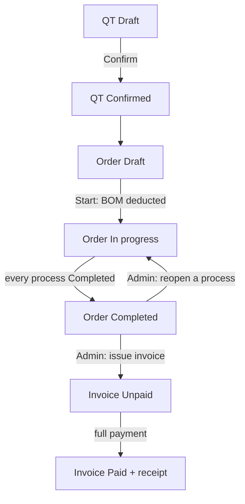
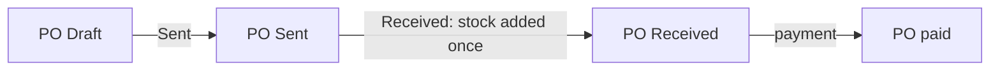

# State and Permission Matrix

Two questions on one page: **who may do what** (role and department), and **what may be done in each status** (the locks). Both are checked by the backend on every call; the frontend only hides what a user may not use.

## 1. Roles

| Role | Department | Meaning |
|---|---|---|
| Admin | any (only a label) | does everything |
| Worker | Sales | Sale Worker: quotations (a production order is read only) |
| Worker | Factory | Factory Worker: the processes, production, stock, purchase |

A Worker must have the department `Sales` or `Factory`; the department decides the access. The role check comes before the check that the record exists: a user who may not touch a record gets `403`, never `404`.

## 2. Who may do what

| Area | Action | Admin | Sale Worker | Factory Worker |
|---|---|---|---|---|
| Dashboard | order tiles | yes | yes | yes |
| Dashboard | invoice tiles and chart | yes | no | no |
| QT | see, create, change, print | yes | yes | no |
| QT | upload customer PO, Confirm, delete a Draft | yes | yes | no |
| Production order | read | yes | yes | yes |
| Production order | add or change the processes before the start | yes | no | yes |
| Production order | Start production (deducts stock) | yes | no | yes |
| Production order | Record progress | yes | no | yes |
| Production order | change or reopen a Completed process | yes | no | no |
| Production order | evidence files: read | yes | yes | yes |
| Production order | evidence files: upload, delete | yes | no | yes |
| Stock | read materials, lots, movements | yes | yes | yes |
| Stock | Add / Deduct / Adjust a lot | yes | no | yes |
| Materials | create, change, delete | yes | no | no |
| Purchase | PO: create, change, print, move status, pay, files | yes | no | yes |
| Suppliers | read | yes | no | yes |
| Suppliers | create, change, delete | yes | no | no |
| Customers | read | yes | yes | no |
| Customers | create, change, delete | yes | no | no |
| Products | read | yes | yes | yes |
| Products | create, change, delete | yes | no | no |
| Accounting | invoices, payments, receipts | yes | no | no |
| Users | read, create, change, delete | yes | no | no |

Menus follow the same table: an entry shows only for the roles and departments that may use it.

## 3. Statuses and what each allows

### QT

| Status | Customer and lines | Other fields | Delete | Confirm | Next |
|---|---|---|---|---|---|
| Draft | change | change | yes | yes (once) | Confirmed |
| Confirmed | locked (`409 QT_LOCKED`) | change | no (`409 IN_USE`) | already done: shows the existing order | – |

Confirm needs a customer and at least one line. A missing customer PO file is only a warning. Confirm makes one Draft production order and copies the PO file to it.

### Production order (status is computed from its processes)

| Status | Edit lines and processes | Start | Record progress | Next |
|---|---|---|---|---|
| Draft, not started | yes (Admin, Factory Worker) | needs a line, a process on every line and enough stock (`409 ORDER_NOT_READY`, `409 STOCK_SHORT`) | no (`409 ORDER_NOT_STARTED`) | In progress |
| In progress | no (locked by the start) | already started | yes | Completed |
| Completed | no | – | no, except an Admin reopening a process (note required) | invoiced |
| Invoiced | no | – | no (`409 ORDER_INVOICED`) | – |

### Process

| Status | Quantity | Who may change |
|---|---|---|
| Not started | 0 | Admin, Factory Worker |
| In progress | partial | Admin, Factory Worker |
| Completed | the full quantity | Admin only; reopening needs a note (`403 COMPLETED_LOCKED` for a Worker) |

### Purchase order

| Status | Change lines | Delete | Files | Payment | Next (by hand, one step only) |
|---|---|---|---|---|---|
| Draft | yes | yes | yes | no | Sent |
| Sent | no (`409 PO_LOCKED`) | no | yes | no | Received |
| Received | no | no | yes | once (`409 ALREADY_PAID`) | – |

Received adds the stock once, into the lot typed for each line; a second Received changes nothing (`409 INVALID_STATUS_CHANGE`). Payment before Received answers `409 PO_NOT_RECEIVED`. The amount must equal the total.

### Invoice

| Status | Payment | Result |
|---|---|---|
| Unpaid | one full payment (amount = total) | Paid |
| Paid | no (`409 ALREADY_PAID`) | receipt issued, once |

An invoice is made only for a Completed order (`409 ORDER_NOT_COMPLETED`), one per order (`409 INVOICE_EXISTS`), as a snapshot. It locks the progress of the order.

### Supplier (the only record with an Active switch)

| Active | New or changed PO | Existing POs |
|---|---|---|
| yes | can be chosen | unchanged |
| no | cannot be chosen | stay as they are |

## 4. One job through the statuses

## 5. Locks at a glance

| Lock | Starts when | What it blocks | Error |
|---|---|---|---|
| QT locked | Confirm | change of customer and lines, delete | `QT_LOCKED`, `IN_USE` |
| Order locked | Start production | change of lines and processes | `ORDER_LOCKED` |
| Completed process | process Completed | change by a Worker | `COMPLETED_LOCKED` |
| Order invoiced | invoice issued | progress updates | `ORDER_INVOICED` |
| PO locked | status leaves Draft | change and delete of the PO | `PO_LOCKED` |
| PO file copy | Confirm QT | delete of the PO file copy on the order | `FILE_LOCKED` |
| In use | another record uses it | delete of customers, products, materials, suppliers | `IN_USE` |
