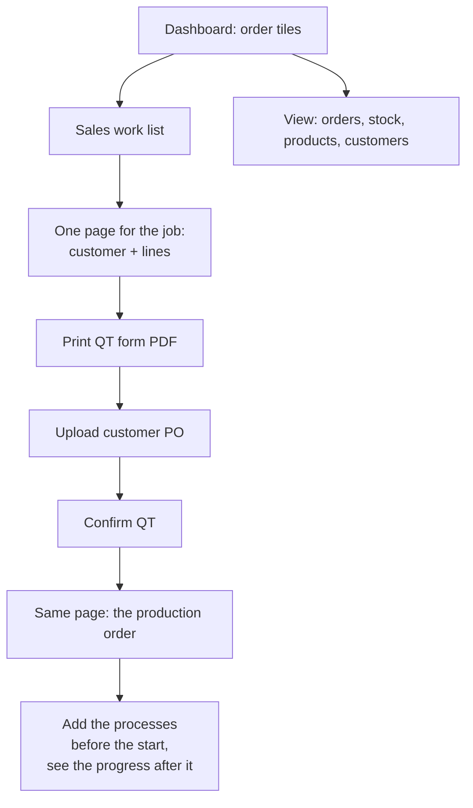
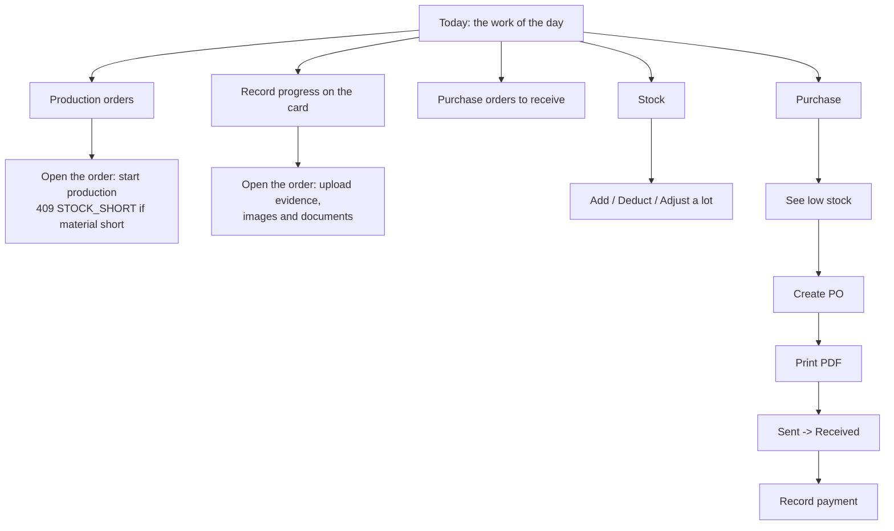
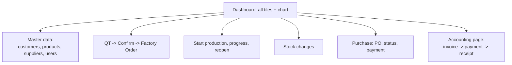
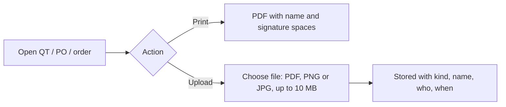

# User Flow

The system as built on branch `mini-erp` (Version 2.0): the three changes ([Purchase Logic Draft2](../docs/Purchase%20Logic%20Draft2.md), [QT Upgrade 2.0](../docs/QT%20Upgrade%202.0.md), [User Version 2.0](../docs/User%20Version%202.0.md)) are in. This replaces the older single-version description.

## Sale Worker

## Factory Worker

## Admin

The Admin can do everything the two Workers can.

## Who can do what

| Area | Admin | Sale Worker | Factory Worker |
|---|---|---|---|
| QT: create, print, upload PO, confirm | yes | yes | no access |
| Production orders: create / edit before start | yes | yes | no |
| Start production, record progress | yes | no | yes |
| Evidence upload (production order) | yes | no | yes |
| Stock: view | yes | yes | yes |
| Stock changes by hand | yes | no | yes |
| Purchase: PO, status, print, payment | yes | no | yes |
| Suppliers | yes | no | view only |
| Customers | yes | view only | no |
| Products | yes | view only | view only |
| Invoices, receipts, users | yes | no | no |

## Print and upload (any page with files)

