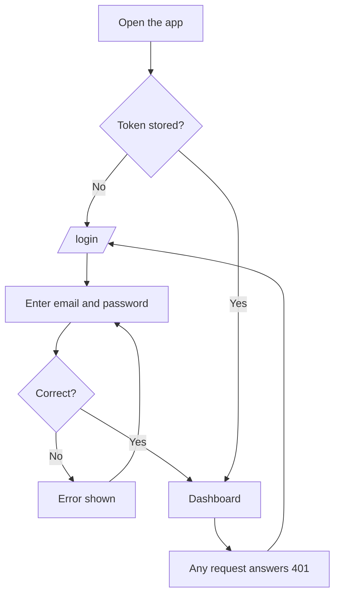
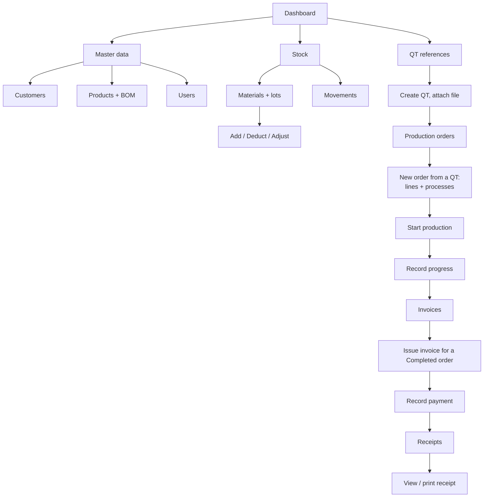
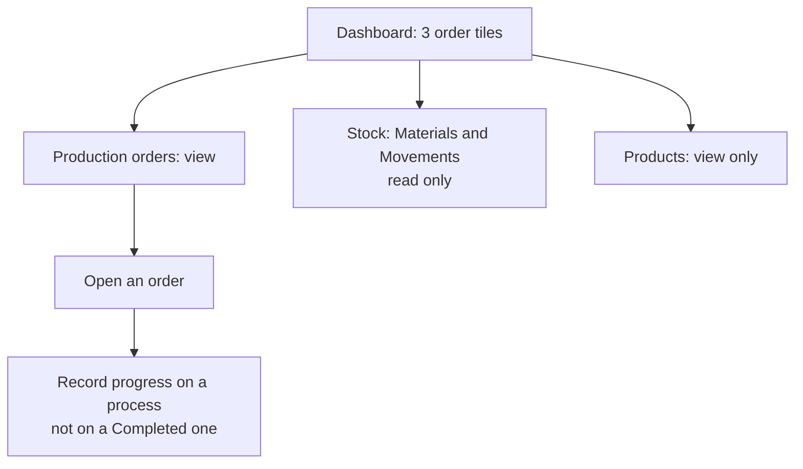

# User Flow

What each role does on screen. Roles: **Admin** and **Worker** (the only thing that decides access). Source: [frontend/src/config/navigation.js](../frontend/src/config/navigation.js) and [docs/api](../docs/api/README.md).

## Sign in (both roles)

## Admin

## Worker

## Who can do what

| Area | Admin | Worker |
|---|---|---|
| Dashboard | orders tiles, invoice tiles, chart | order tiles only |
| QT references | full | no access (`403`) |
| Production orders | create, edit before start, start, progress | view, progress (not on a Completed process) |
| Completed process | change or reopen | locked |
| Stock | read and change | read only |
| Invoices, receipts | full | no access |
| Customers, users | full | no access |
| Products | full | read only |
