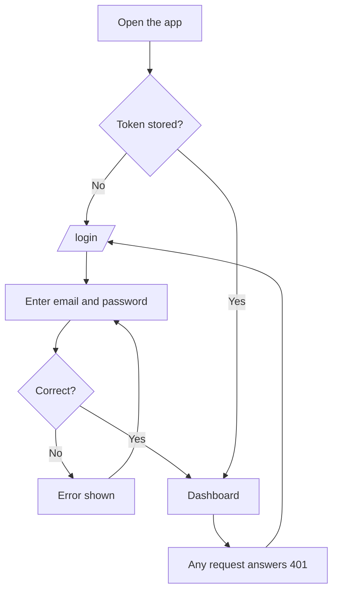
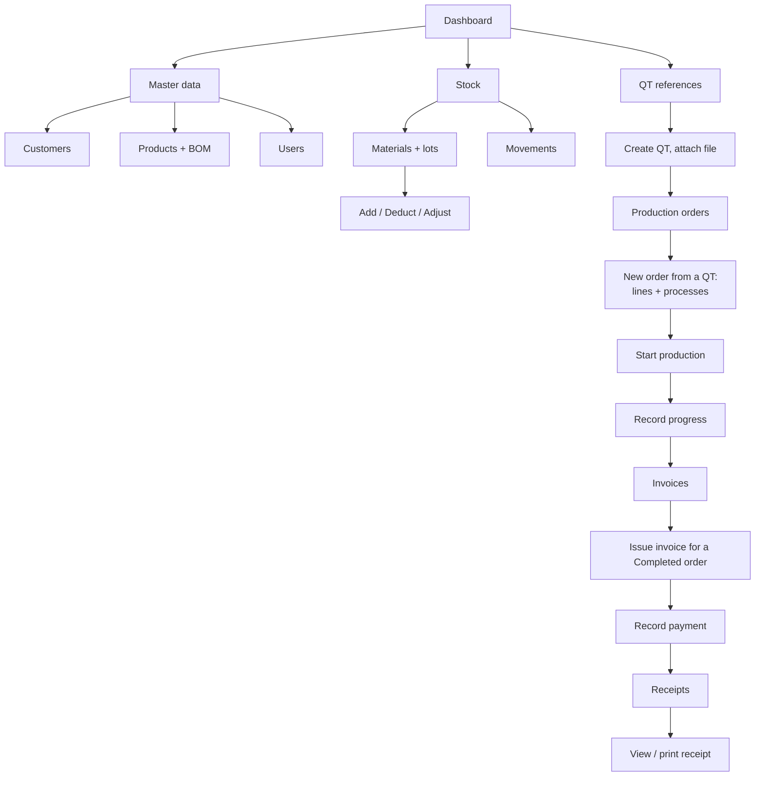
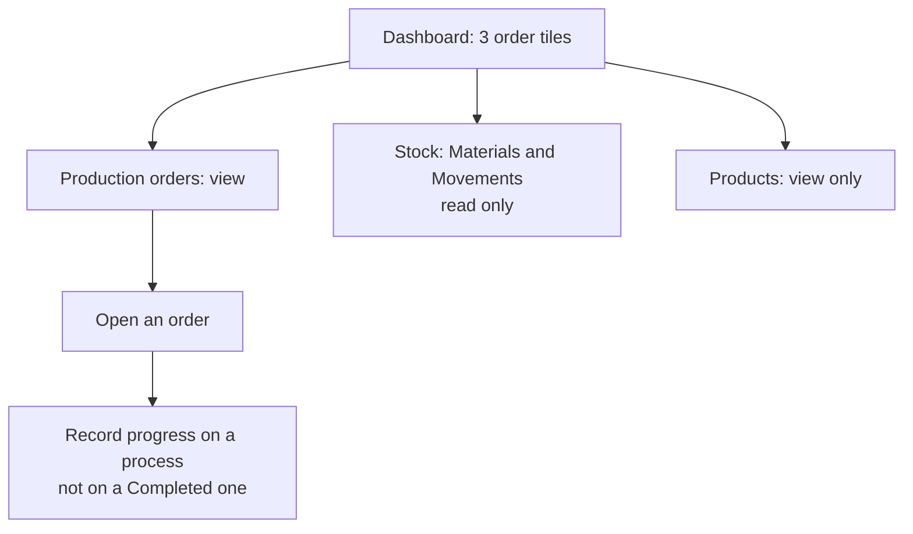
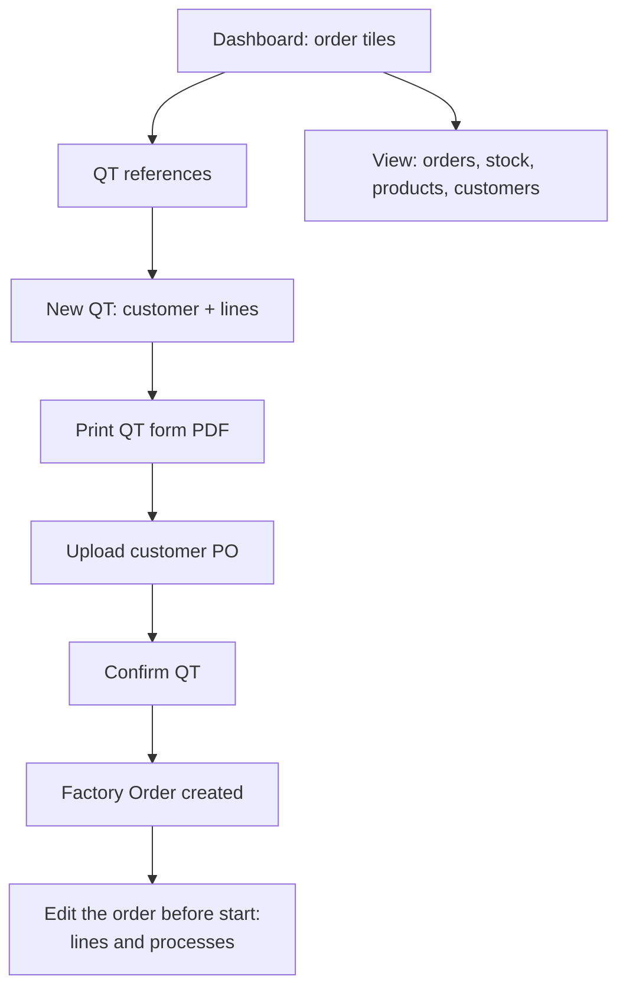
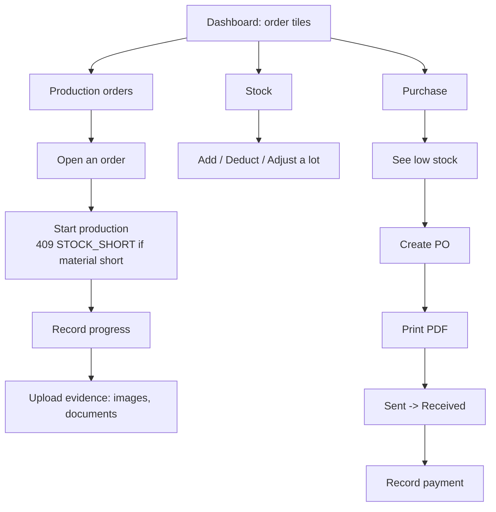
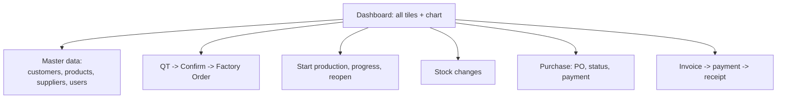
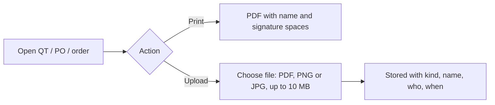

# User Flow

One file with both versions: **Part 1** is the system as built on branch `mini-erp`; **Part 2** is Version 2.0 (planned): Purchase ([Purchase Logic Draft2](../docs/Purchase%20Logic%20Draft2.md)), QT Upgrade 2.0 ([doc](../docs/QT%20Upgrade%202.0.md)) and User Version 2.0 ([doc](../docs/User%20Version%202.0.md)).

## Part 1: Current version (as built)

What each role does on screen. Roles: **Admin** and **Worker** (the only thing that decides access). Source: [frontend/src/config/navigation.js](../frontend/src/config/navigation.js) and [docs/api](../docs/api/README.md).

### Sign in (both roles)

### Admin

### Worker

### Who can do what

| Area | Admin | Worker |
|---|---|---|
| Dashboard | orders tiles, invoice tiles, chart | order tiles only |
| QT references | full | no access (`403`) |
| Production orders | create, edit before start, start, progress | view, progress (not on a Completed process) |
| Completed process | change or reopen | locked |
| Stock | read and change | read only |
| Invoices, receipts | full | no access |
| Customers, users | full | no access |
| Products | full | read only |

---

## Part 2: Version 2.0 (planned)

What each role does on screen after the three changes. The current version is in [Part 1](#part-1-current-version-as-built). Roles: **Admin**, **Sale Worker** (`Worker` + `Sales`), **Factory Worker** (`Worker` + `Factory`). See [User Version 2.0](../docs/User%20Version%202.0.md).

### Sale Worker

### Factory Worker

### Admin

The Admin can do everything the two Workers can.

### Who can do what

| Area | Admin | Sale Worker | Factory Worker |
|---|---|---|---|
| QT: create, print, upload PO, confirm | yes | yes | no access |
| Production orders: create / edit before start | yes | yes | no |
| Start production, record progress | yes | no | yes |
| Evidence upload (production order) | yes | no | yes |
| Stock: view | yes | yes | yes |
| Stock changes by hand | yes | no | yes |
| Purchase: PO, status, print, payment | yes | no | yes |
| Suppliers | yes | no | view only |
| Customers | yes | view only | no |
| Products | yes | view only | view only |
| Invoices, receipts, users | yes | no | no |

> The Purchase rights are not decided in the notes. This table gives them to the Factory Worker because that department handles materials. Confirm with the user.

### Print and upload (any page with files)

