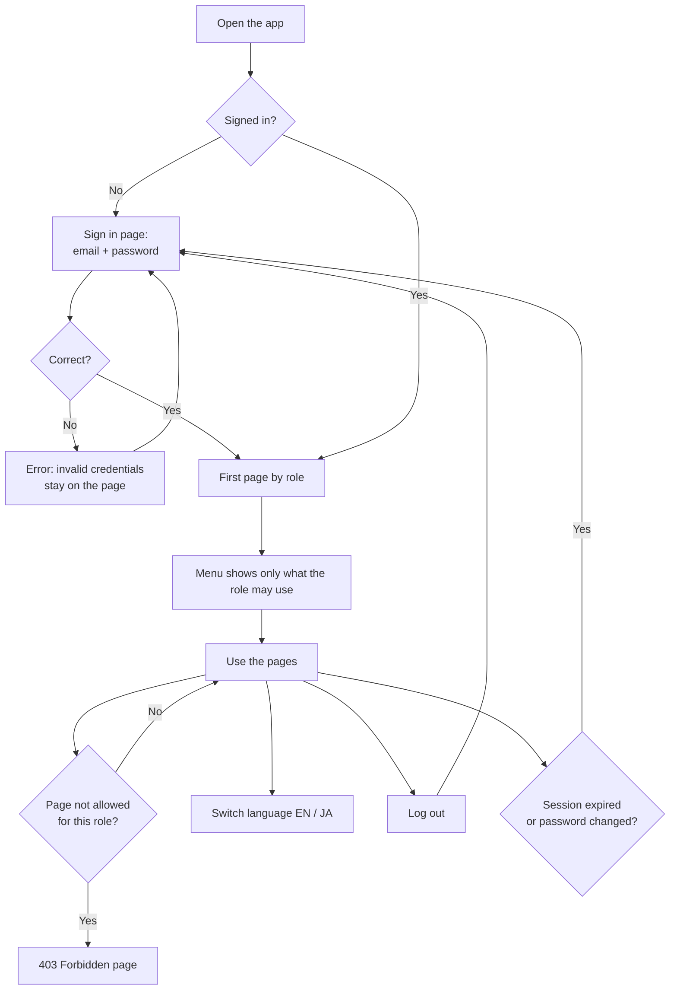
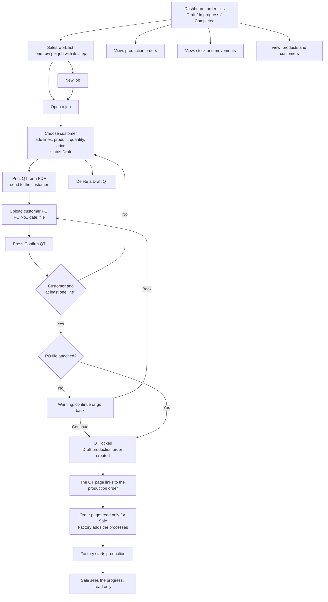
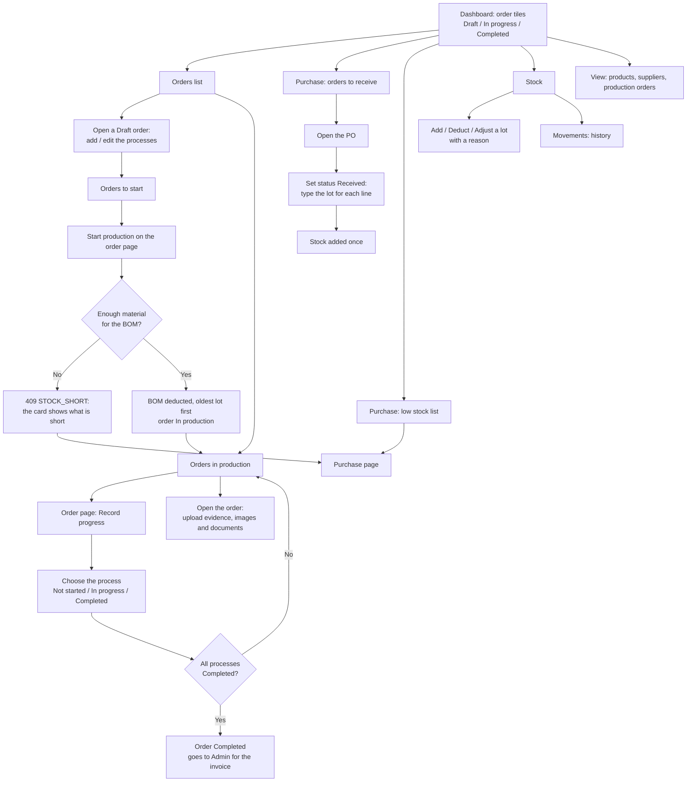
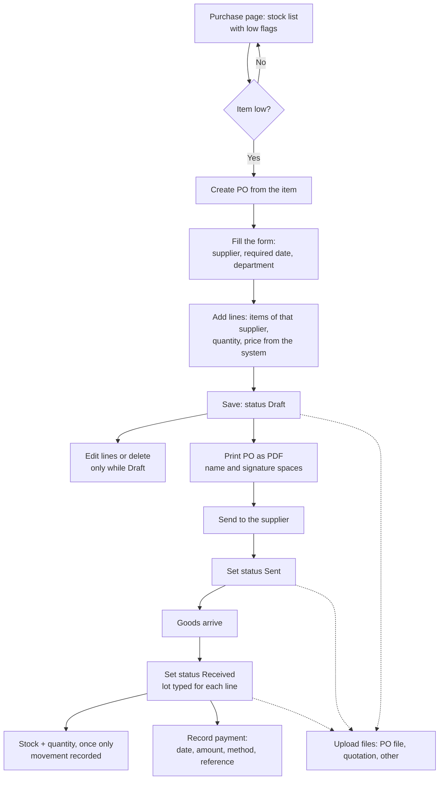
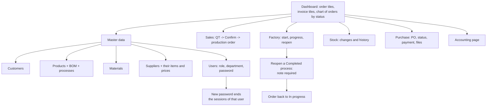
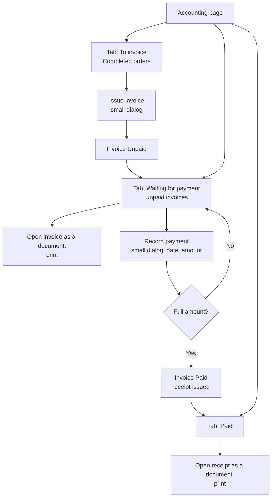
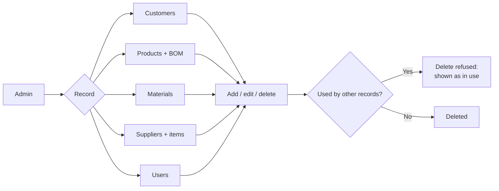
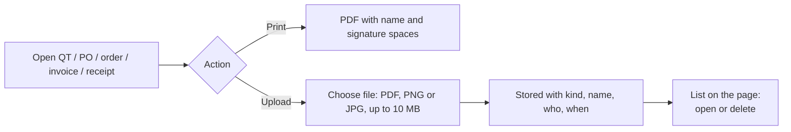

# User Flow

How each user works through the system, by role. The order of the work is in [Flow Chart](Flow%20Chart.md); the pages are in [Site Map](Site%20Map.md).

## Roles

| Role | Department | Who | First page |
|---|---|---|---|
| Admin | any (only a label) | Owner / office: does everything | Dashboard: order tiles, invoice tiles, chart |
| Worker | Sales | Sale Worker: quotations (a production order is only read) | Dashboard: order tiles |
| Worker | Factory | Factory Worker: the processes, production, stock, purchase | Dashboard: order tiles |

A Worker must have the department `Sales` or `Factory`; the department decides what the Worker can do. There is no sign-up and no forgot-password: an Admin makes the accounts and sets the passwords.

## Everyone: sign in and move around

- The menu hides what the user may not use; the backend checks the same rules on every call.
- A menu that has only one visible entry is shown as that entry alone.
- An unknown address opens the Not found page; old addresses of moved pages are redirected.

## Sale Worker

What the Sale Worker cannot do: add or change the processes of an order, start production, record progress, change stock, open Purchase, Accounting, Suppliers or Users. A confirmed QT is locked and cannot be deleted; an order cannot be made by hand, only by Confirm QT.

## Factory Worker

A Factory Worker cannot reopen a Completed process (Admin only), cannot change QT, customers, products or materials, and cannot open Accounting or Users.

## Purchase (Factory Worker and Admin)

Suppliers and their items and prices are kept by the Admin; the Factory Worker can only view them.

## Admin

The Admin can do everything the two Workers can.

## Admin: accounting

## Master data

Sale Worker: view customers and products. Factory Worker: view products and suppliers.

## Who can do what

| Area | Admin | Sale Worker | Factory Worker |
|---|---|---|---|
| Dashboard | all tiles + chart | order tiles | order tiles |
| QT: create, print, upload PO, confirm, delete a Draft | yes | yes | no access |
| Production orders: view | yes | yes | yes |
| Production orders: add / edit the processes before start | yes | no | yes |
| Start production, record progress | yes | no | yes |
| Reopen a Completed process | yes | no | no |
| Evidence upload (production order) | yes | no | yes |
| Stock: view and movements | yes | yes | yes |
| Stock changes by hand | yes | no | yes |
| Materials: add, edit, delete | yes | no | no |
| Purchase: PO, status, print, payment, files | yes | no | yes |
| Suppliers | yes | no | view only |
| Customers | yes | view only | no |
| Products | yes | view only | view only |
| Invoices, receipts | yes | no | no |
| Users | yes | no | no |

## Print and upload (any page with files)

| Page | Files |
|---|---|
| QT | customer PO |
| Production order | evidence: images and documents (Admin, Factory) |
| Purchase order | PO file, quotation, other files |

## Errors a user may see

| Message | When | What to do |
|---|---|---|
| Invalid credentials | wrong email or password | try again; ask the Admin to reset |
| 403 Forbidden page | a page or action the role may not use | go back; ask the Admin |
| 409 STOCK_SHORT | start production without enough material | purchase or add stock, then start again |
| Validation error | a required field is missing (QT without customer or line) | fill the field |
| In use | delete of a record other records use | keep it, or remove the uses first |
| Session ended | token expired or password changed | sign in again |
